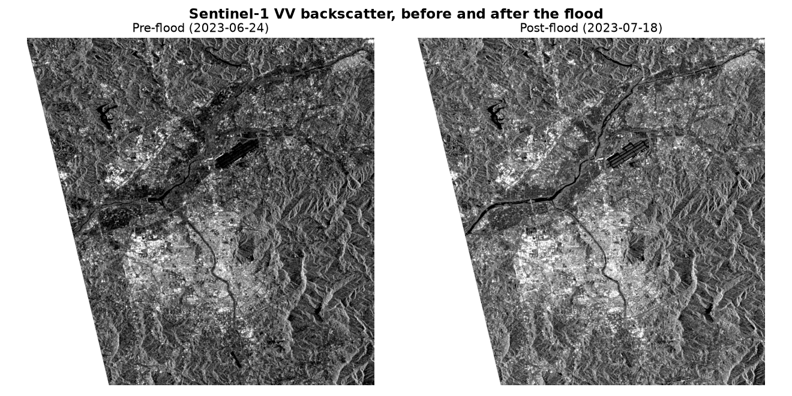
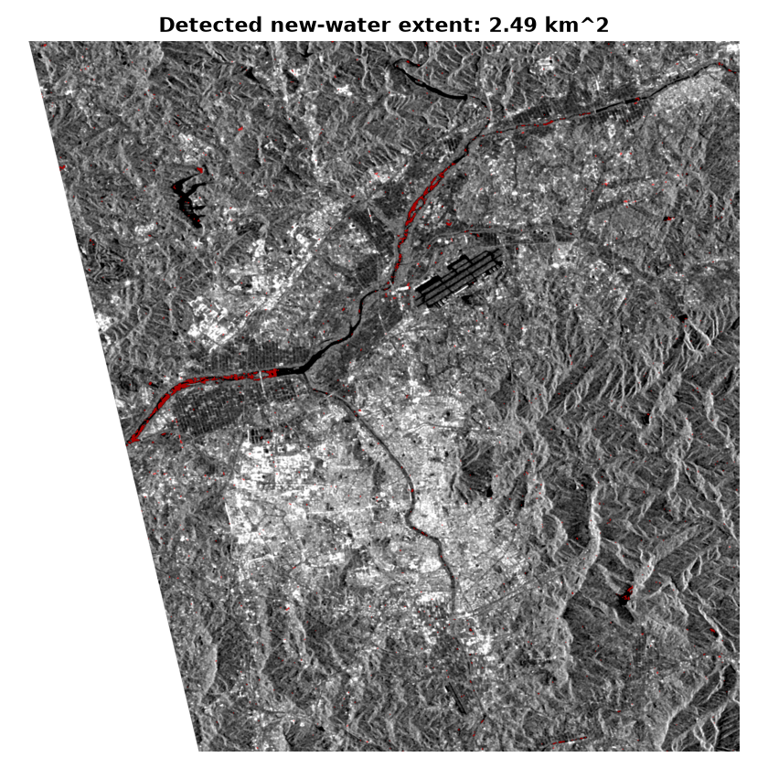

# floodscope

**Flood-extent change detection from public Sentinel-1 SAR imagery — sees through cloud cover, no downloads, no credentials.**

Optical satellites can't see through clouds — which is exactly the condition during and after most floods. `floodscope` uses Sentinel-1 Synthetic Aperture Radar (SAR) instead, which images straight through cloud cover, reading Cloud-Optimized GeoTIFFs directly over HTTP from a public STAC catalog ([AWS Earth Search](https://earth-search.aws.element84.com/v1)). Give it an AOI and a before/after date, and it finds a same-orbit scene pair, geocodes them, and flags newly-flooded pixels — one function call or one CLI command.

## Real result: the July 2023 Cheongju / Miho River flood, South Korea

A temporary embankment near the Miho River breached on 2023-07-15 after days of heavy rain, flooding the Gungpyeong 2 underpass in Osong. Below is real, unedited output from [`examples/build_demo.py`](examples/build_demo.py) — see [`examples/demo.ipynb`](examples/demo.ipynb) for the full walkthrough.



The river channel is visible as a dark line in both scenes, but the two aren't visually distinguishable at a glance — the flood signal only emerges from the *difference* between them, since calm open water is a near-specular reflector that returns very little energy to the radar:



`floodscope` estimates **2.49 km²** of new open water. Notice how the detected extent concentrates right at the tributary confluence — exactly the kind of backwater location where overbank flooding and embankment breaches are most likely, and consistent with this flood's actual documented cause.

## Install

```bash
pip install -e ".[dev]"       # core library + tests
pip install -e ".[demo]"      # + matplotlib/jupyter, to regenerate the images above
```

Requires Python 3.10+. `rasterio`'s PyPI wheels bundle GDAL, so no separate GDAL install is needed.

## Usage

### Library

```python
from floodscope import search_items, find_nearest_item, filter_same_orbit, read_geocoded_band, to_db, despeckle, detect_flood, export_cog

bbox = (127.35, 36.55, 127.60, 36.80)  # west, south, east, north (WGS84)

pre_candidates = search_items(bbox=bbox, datetime="2023-06-15T00:00:00Z/2023-07-01T23:59:59Z")
pre_item = find_nearest_item(pre_candidates, "2023-06-24")

post_candidates = search_items(bbox=bbox, datetime="2023-07-10T00:00:00Z/2023-07-25T23:59:59Z")
post_candidates = filter_same_orbit(post_candidates, pre_item)  # same viewing geometry
post_item = find_nearest_item(post_candidates, "2023-07-18")

pre_dn, transform, crs = read_geocoded_band(pre_item.assets["vv"].href, bbox)
post_dn, _, _ = read_geocoded_band(post_item.assets["vv"].href, bbox)

pre_db = despeckle(to_db(pre_dn))
post_db = despeckle(to_db(post_dn))

result = detect_flood(pre_db, post_db, transform, crs)
print(f"{result.area_km2:.2f} km^2 of new water detected")
export_cog(result, "flood.tif")
```

### CLI

```bash
floodscope search --bbox 127.35,36.55,127.60,36.80 --start 2023-06-01 --end 2023-08-01

floodscope detect \
    --bbox 127.35,36.55,127.60,36.80 \
    --pre-date 2023-06-24 --post-date 2023-07-18 \
    --output flood.tif
```

## How it works

1. **Search** — `pystac-client` queries a STAC API; `filter_same_orbit` keeps only candidates sharing a reference scene's `sat:relative_orbit`/`sat:orbit_state`, since Sentinel-1's viewing geometry (and so its raw backscatter) depends on the orbit track.
2. **Geocode** — raw Sentinel-1 GRD "measurement" GeoTIFFs carry no affine transform, only ~200 Ground Control Points. `read_geocoded_band` warps through those GCPs via `rasterio`'s `WarpedVRT`, windowed directly to the AOI (only the needed bytes are read from the ~1 GB scene).
3. **Convert & despeckle** — digital numbers become a dB backscatter proxy (`to_db`), then a median filter (`despeckle`) knocks down speckle noise.
4. **Detect** — `detect_flood` flags pixels that darkened past a threshold (default -3 dB) between the two dates, then drops connected clusters below a minimum size — isolated single pixels are far more often residual speckle than real flooding.
5. **Export** — the flood mask and the underlying dB difference are written as a 2-band Cloud-Optimized GeoTIFF.

### Scope / known limitations

- **No radiometric calibration.** Converting digital numbers to physical sigma0 backscatter needs a per-pixel gain correction from the product's calibration annotation LUT (angle- and range-dependent) — out of scope here. Because `filter_same_orbit` guarantees identical viewing geometry between the two dates, the *relative* difference this pipeline detects on is still meaningful without it; it does mean the dB values themselves aren't physically calibrated.
- **Open-water flooding only.** Calm floodwater is dark in SAR (specular reflection), which is what the threshold detects. Flooded vegetation or urban areas can instead *brighten* via double-bounce scattering — a real signature this simple threshold does not attempt to capture.
- **Single-tile/swath assumption.** Both scenes must actually cover the requested AOI; no mosaicking across swath edges.

## Tests

```bash
pytest                        # everything, including one real network integration test
pytest -m "not integration"   # fast unit tests only (what CI runs) -- pure logic, synthetic arrays, no network
```

## License

MIT — see [LICENSE](LICENSE).
