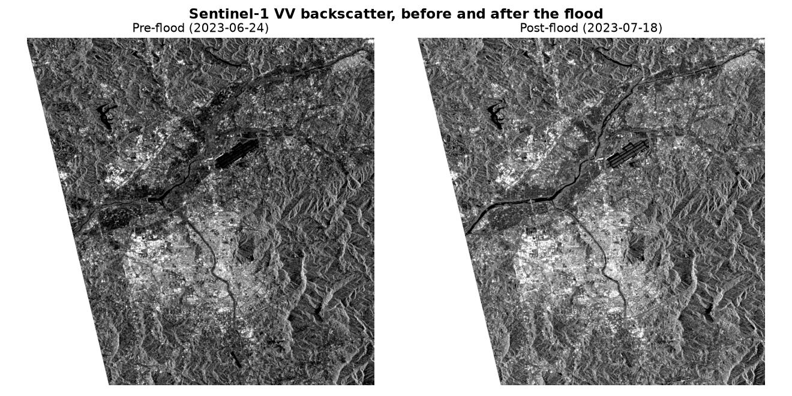
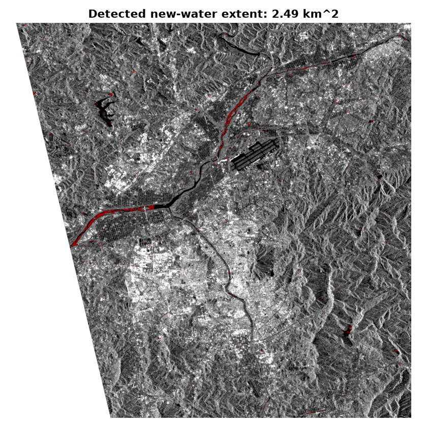

# floodscope

[](https://github.com/SeongjunLee4473/floodscope/actions/workflows/ci.yml)
[](pyproject.toml)
[](LICENSE)
[](https://earth-search.aws.element84.com/v1)
[](https://earth-search.aws.element84.com/v1)

Flood extent change detection from public Sentinel-1 SAR imagery. Radar images through cloud cover, which usually hides floods from optical satellites. `floodscope` reads Cloud-Optimized GeoTIFFs over HTTP from the public [AWS Earth Search](https://earth-search.aws.element84.com/v1) STAC catalog, so no download or account is needed. Given an AOI and dates before and after an event, it finds a scene pair on the same orbit, geocodes both scenes and flags newly flooded pixels with one function call or one CLI command.

## Example: Miho River flood, July 2023

On 2023-07-15 a temporary embankment near the Miho River in Cheongju, South Korea, failed after days of heavy rain and flooded the Gungpyeong 2 underpass in Osong. The figures below are unedited output of [`examples/build_demo.py`](examples/build_demo.py). The full walkthrough is in [`examples/demo.ipynb`](examples/demo.ipynb).



The river channel is dark in both scenes, and the two scenes look alike at a glance. Calm open water reflects the radar pulse away from the sensor, so new flooding shows up in the difference between the scenes.



`floodscope` estimates **2.49 km²** of new open water. The detected area is concentrated at the tributary confluence, where backwater flooding and embankment failures are most likely.

## Installation

```bash
git clone https://github.com/SeongjunLee4473/floodscope.git
cd floodscope
pip install -e ".[dev]"    # library and tests
pip install -e ".[demo]"   # matplotlib and Jupyter, to regenerate the figures
```

Python 3.10 or later is required. The `rasterio` wheels on PyPI include GDAL, so GDAL does not need a separate install.

## Usage

### Python

```python
from floodscope import (
    despeckle, detect_flood, export_cog, filter_same_orbit,
    find_nearest_item, read_geocoded_band, search_items, to_db,
)

bbox = (127.35, 36.55, 127.60, 36.80)  # west, south, east, north (WGS84)

pre_candidates = search_items(bbox=bbox, datetime="2023-06-15T00:00:00Z/2023-07-01T23:59:59Z")
pre_item = find_nearest_item(pre_candidates, "2023-06-24")

post_candidates = search_items(bbox=bbox, datetime="2023-07-10T00:00:00Z/2023-07-25T23:59:59Z")
post_candidates = filter_same_orbit(post_candidates, pre_item)  # same viewing geometry
post_item = find_nearest_item(post_candidates, "2023-07-18")

pre_dn, transform, crs = read_geocoded_band(pre_item.assets["vv"].href, bbox)
post_dn, _, _ = read_geocoded_band(post_item.assets["vv"].href, bbox)

result = detect_flood(despeckle(to_db(pre_dn)), despeckle(to_db(post_dn)), transform, crs)
print(f"{result.area_km2:.2f} km² of new water")
export_cog(result, "flood.tif")
```

### Command line

```bash
floodscope search --bbox 127.35,36.55,127.60,36.80 --start 2023-06-01 --end 2023-08-01

floodscope detect \
    --bbox 127.35,36.55,127.60,36.80 \
    --pre-date 2023-06-24 --post-date 2023-07-18 \
    --output flood.tif
```

## Method

| Step | Function | What happens |
|:--|:--|:--|
| Search | `search_items`, `filter_same_orbit` | Queries the STAC API with `pystac-client` and keeps scenes with the same `sat:relative_orbit` and `sat:orbit_state` as the reference, because backscatter depends on viewing geometry. |
| Geocode | `read_geocoded_band` | Sentinel-1 GRD measurement files have no affine transform, only about 200 ground control points. The band is warped through the GCPs with `rasterio`'s `WarpedVRT` and read only for the AOI window, not the whole scene of about 1 GB. |
| Convert and despeckle | `to_db`, `despeckle` | Converts digital numbers to a dB backscatter proxy and applies a median filter to reduce speckle. |
| Detect | `detect_flood` | Flags pixels that darkened by more than the threshold (default -3 dB) and removes connected clusters smaller than `min_pixels` (default 8), which are more often speckle than flooding. |
| Export | `export_cog` | Writes the flood mask and the dB difference as a two-band Cloud-Optimized GeoTIFF. |

## Limitations

- **No radiometric calibration.** Converting digital numbers to sigma0 needs the per-pixel calibration LUT of each product, which is not applied. Because both scenes share the same orbit and geometry, the relative change is still meaningful, but the dB values are not physically calibrated.
- **Open water only.** The threshold detects water that turns dark. Flooded vegetation and urban areas can turn brighter through double-bounce scattering, which this method does not detect.
- **Single swath.** Both scenes must cover the whole AOI. Scenes are not mosaicked across swath edges.

## Tests

```bash
pytest                         # all tests, including one network integration test
pytest -m "not integration"    # unit tests only, as run in CI (synthetic arrays, no network)
```

## License

Released under the [MIT License](LICENSE).
